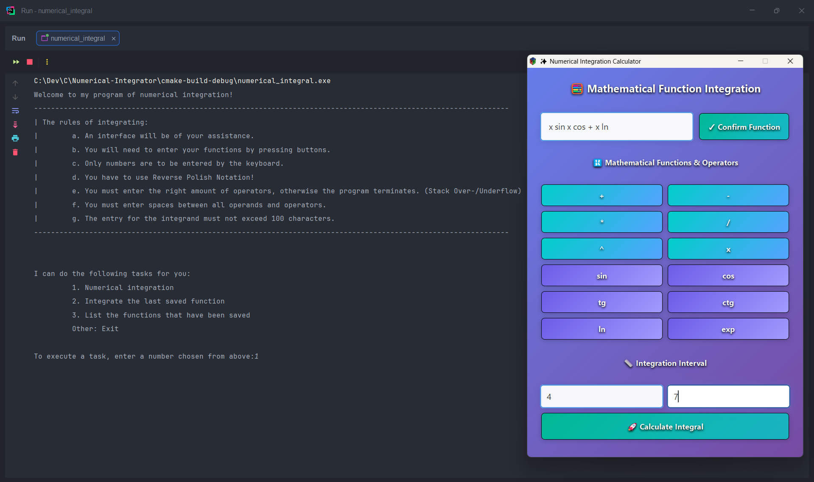
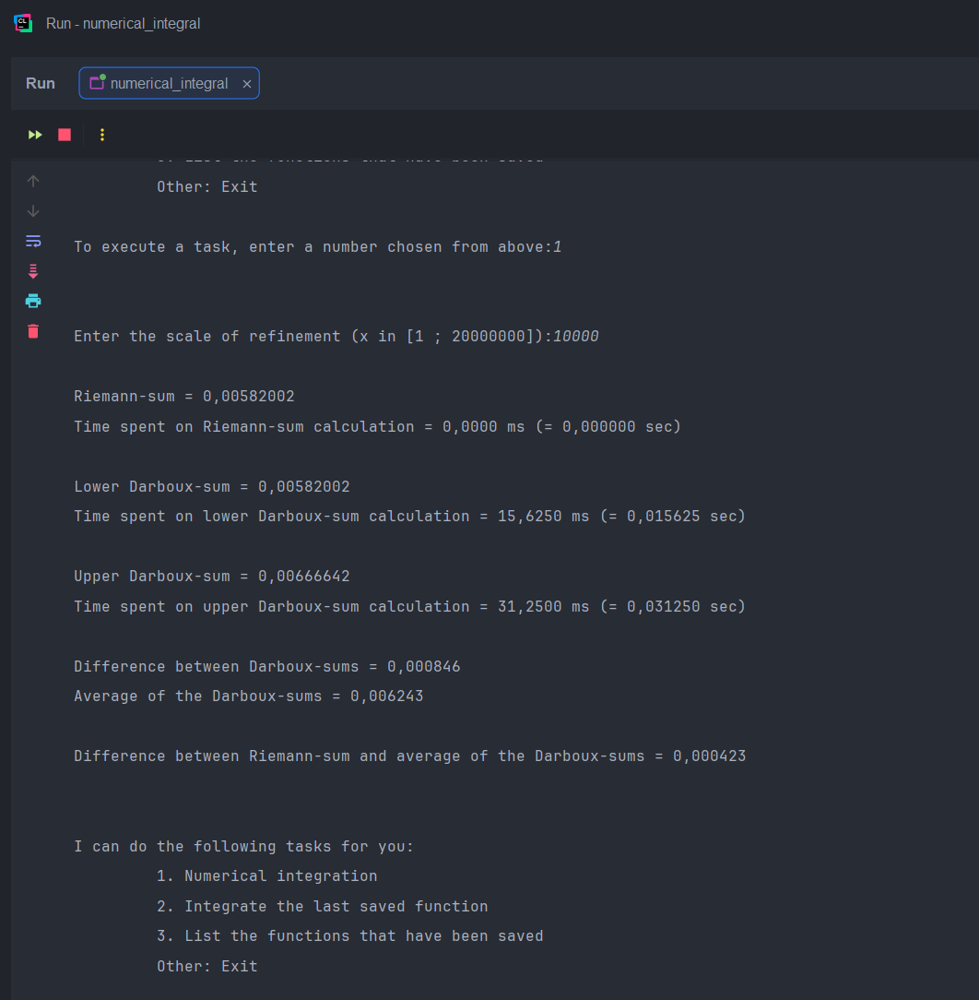

<div align="center">
    <h1>Numerical Integrator</h1>
    
    
    
</div>

<p align="center">
    <strong>A modern, user-friendly numerical integration system with mathematical expression parsing and a sleek graphical interface.</strong>
</p>

---

## ✨ Overview

The **Numerical Integrator** is a sophisticated C application designed to compute definite integrals of mathematical functions using multiple numerical methods. It combines powerful expression parsing, precise numerical integration algorithms, and an intuitive graphical user interface to provide a complete solution for mathematical integration problems.

---

## 📸 Screenshots

<p align="center">
    
    
</p>

---

## 🚀 Features

### Mathematical Core

- **Multiple Integration Methods**:
  - Riemann Sum approximation
  - Lower and Upper Darboux Sum bounds
  - Error estimation between approximation methods

- **Comprehensive Expression Support**:
  - Variables (x)
  - Numeric constants
  - Binary operators (+, -, *, /, ^)
  - Mathematical functions (sin, cos, tg, ctg, ln, exp)

- **Robust Parsing System**:
  - Reverse Polish Notation (RPN) support
  - Abstract Syntax Tree (AST) representation
  - Efficient expression evaluation

### System Design

- **Modular Architecture**:
  - Separation of concerns across specialized modules
  - Clean interfaces between components
  - Maintainable and extensible codebase

- **Memory Safety**:
  - Comprehensive resource management
  - Memory leak prevention
  - Debug utilities for development

- **Error Handling**:
  - Input validation at multiple levels
  - Graceful error recovery
  - Clear user feedback

## 📦 Project Architecture

The project is organized into specialized modules, each with distinct responsibilities:

### Module Structure

```
src/
├── integrator/     # Numerical integration algorithms
├── parser/         # Mathematical expression parsing
├── controls/       # Coordination and validation
├── ui/             # Graphical user interface
└── memcheck/       # Memory debugging utilities
```

### Module Interactions

```
┌─────────────┐      ┌──────────────┐
│     UI      │─────▶│   Controls   │
└─────────────┘      └──────┬───────┘
      ▲                     │
      │                     ▼
┌─────┴───────┐      ┌──────────────┐
│  Integrator  │◀────┤    Parser    │
└─────────────┘      └──────────────┘
```

### Numerical Integration Engine

The integration module implements three different approaches:

- **Riemann Sum**: Approximates the integral by evaluating the function at left endpoints
- **Lower Darboux Sum**: Uses minimum function values in each subinterval
- **Upper Darboux Sum**: Uses maximum function values in each subinterval

Providing multiple methods allows for error estimation and accuracy assessment.

### Expression Parser

The parser converts mathematical expressions from RPN format into an abstract syntax tree (AST):

```
Example: "2 x * 1 +" (representing 2*x + 1)

    (+)
   /   \
  (*)   (1)
 /   \
(2)   (x)
```

This tree structure allows for efficient evaluation at any point within the integration interval.


## 🚀 Getting Started

### Prerequisites

- C Compiler (GCC recommended)
- GTK+ 3.0 Development Libraries
- CMake (3.10 or higher)

### Building the Project

1. Clone the repository:
   ```bash
   git clone https://github.com/yourusername/numerical-integrator.git
   cd numerical-integrator
   ```

2. Create build directory:
   ```bash
   mkdir build && cd build
   ```

3. Configure and build:
   ```bash
   cmake ..
   make
   ```

4. Copy required assets:
   ```bash
   cp ../src/ui/styles.css .
   ```

## 🎯 Usage Guide

### Starting the Application

```bash
./numerical_integral
```

### Using the Interface

1. **Enter Your Function**:
   - Use the mathematical buttons for operators and functions
   - Enter numbers via keyboard
   - Functions use Reverse Polish Notation (e.g., `x sin` for sin(x))
   - Click "Confirm Function" when ready

2. **Specify Integration Interval**:
   - Enter lower and upper bounds
   - Click "Calculate Integral"

3. **Select Refinement Level**:
   - Enter a number between 1 and 20,000,000
   - Higher values provide more accurate results

4. **View Results**:
   - Riemann sum approximation
   - Lower and upper Darboux sums
   - Error bounds and average approximation

### Example Calculation

**Function**: x² + 1 (entered as `x x * 1 +`)
**Interval**: [0, 5]
**Refinement**: 1000

**Results**:
```
Riemann-sum = 46,734187
Lower Darboux-sum = 46,734187
Upper Darboux-sum = 46,859285

Difference between Darboux-sums = 0,125098
Average of the Darboux-sums = 46,796736

Difference between Riemann-sum and average of the Darboux-sums = 0,062549
```

## 📋 Supported Mathematical Functions

| Function | Description | Example (RPN) |
|----------|-------------|--------------|
| + | Addition | `2 3 +` |
| - | Subtraction | `5 2 -` |
| * | Multiplication | `2 x *` |
| / | Division | `x 2 /` |
| ^ | Exponentiation | `x 2 ^` |
| sin | Sine (radians) | `x sin` |
| cos | Cosine (radians) | `x cos` |
| tg | Tangent (radians) | `x tg` |
| ctg | Cotangent (radians) | `x ctg` |
| ln | Natural logarithm | `x ln` |
| exp | Exponential function | `x exp` |

